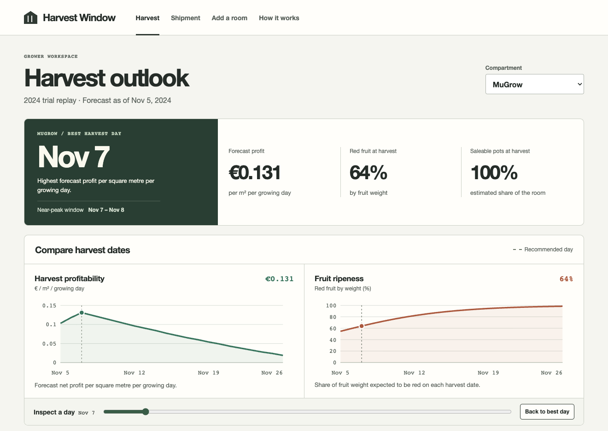
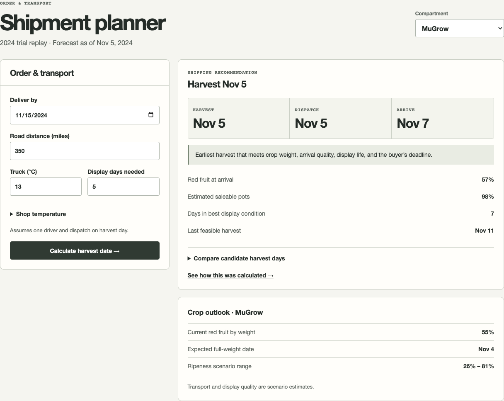

# Harvest Window

**When should a grower harvest a room of dwarf tomatoes?** The whole pot is sold in one harvest. Picking early leaves green pots that cannot be sold. Waiting brings more fruit into saleable condition, but also adds another day of heat, lighting and greenhouse occupancy. Harvest Window estimates what that extra day is worth.

Team Root Access built this decision tool for the **2026 Precision & Digital Agriculture Hackathon**, Track 1, Challenge 2. The demo replays six greenhouse compartments from Wageningen’s 2024 Autonomous Greenhouse Challenge. A grower can compare harvest dates, inspect the weighed pots and camera images behind a forecast, and plan a shipment against a buyer’s deadline.



## One room, one decision

On **November 5**, the MuGrow sample put the room at about **55% red fruit by weight**. The model recommended harvesting on **November 7**, with November 8 still within 10% of peak forecast profit. Moving the date slider shows why. By November 11 the fruit is redder, but the model already expects every pot to meet the sale threshold on November 7.

| Candidate day | Forecast red fruit by weight | Estimated saleable pots | Forecast net profit per m² per growing day |
| --- | ---: | ---: | ---: |
| Nov 5 | 55% | 95% | €0.103 |
| **Nov 7** | **64%** | **100%** | **€0.131** |
| Nov 8 | 68% | 100% | €0.124 |
| Nov 11 | 79% | 100% | €0.103 |

The **near-peak window** answers a scheduling question under the central forecast. Ripening uncertainty is wider. Under the model’s early and late ripening scenarios, MuGrow’s best day ranges from November 5 to 13. A fresh weighing helps a grower decide whether to act on the central estimate. [Published daily recommendations](data/published/days.json) · [Daily forecast values](data/published/forecast.json)

## How the model picks a harvest day

1. **Estimate how fast the fruit is ripening.** The model accumulates warmth above 10 °C and fits an S-shaped ripening curve using the other rooms. Three consecutive noon images showing red fruit help locate the start of ripening. When a weighed sample is available, the model moves its estimate toward the measured red share. It projects the next 21 days using the room’s warmth rate over the past week. [Ripening model](harvest/forecast.py)
2. **Estimate what each pot can earn.** Pots in the same room ripen at different rates. The model represents that spread with 40 representative pots. A pot qualifies for sale when at least one-third of its fruit weight is red. The trial’s price curve assigns revenue by grams of red fruit, with no additional payment beyond 150 g per pot. [Scoring assumptions](config/crop.yaml)
3. **Compare the return for each candidate day.** For each square metre, the model multiplies expected revenue per pot by plant density, subtracts plant and accumulated growing costs, then divides by days grown. It selects the highest return among dates with at least 95% saleable pots. If no date qualifies, it reports the best return available and leaves the first saleable date unset. For a positive peak, the near-peak window includes adjacent days earning at least 90% of that return. [Profit calculation and date selection](harvest/economics.py)

## What changes when there is an order?

A buyer can accept pots that ripen during transport. The shipment planner advances ripeness using truck temperature and travel time, then checks fruit weight, saleable share at arrival, display life and the delivery deadline. It returns the earliest harvest satisfying those conditions.

In the MuGrow example below, a **350-mile trip at 13 °C** allows a **November 5 harvest and November 7 arrival**. The planner estimates **98% saleable pots on arrival** and **seven days** in best display condition. These are simulated shipment outcomes. The trial measured the greenhouse crop.



## How well did it forecast?

The team replayed **November 5, 2024**, the last sample date before any room was harvested. Each room’s shared ripening curve was fitted on the other five rooms using measurements available by that date. The timing test asks when the crop would reach the red share later measured at its actual harvest. That target is known retrospectively.

| Mean absolute error across six rooms | Harvest Window | Warmth alone | Simple baseline |
| --- | ---: | ---: | ---: |
| Date the room reached its harvest ripeness | **1.67 days** | 3.00 days | 4.83 days |
| Red fruit by weight on the actual harvest date | **6.24 percentage points** | 10.11 points | 7.01 points |

The date baseline uses the other rooms’ average days from planting to harvest. The ripeness baseline uses their average final red share. In a separate comparison, the dashboard’s **economic recommendation averaged 4.17 days earlier** than the growers’ actual picks. The trial records one harvest per room, so profit on alternative dates remains a model estimate. All six rooms came from one site and season. [Backtest implementation](harvest/backtest.py) · [Per-room results](data/published/backtest.json) · [Evaluation metrics](docs/evaluation.csv)

## Run the demo

The React app includes the trial forecasts and selected canopy photos. From a clone of this repository, use Node.js and npm (tested with Node 24).

```sh
cd web
npm ci
npm run dev
```

Open the local URL printed by Vite. Start in **Harvest** with **MuGrow**, move **Inspect a day** to November 11, then scroll to **Crop evidence** to inspect individual pots. In **Shipment**, keep the example order and select **Calculate harvest date**. **How it works** shows the calculations for that order.

To reproduce the timing evaluation, start at the repository root with Python 3.14 and Make available.

```sh
make setup
.venv/bin/python -m harvest.backtest
make test
```

## Explore the repository

| Location | Contents |
| --- | --- |
| [Grower interface](web/src/grower) | Harvest outlook, shipment planner and custom-room entry |
| [Forecast pipeline](harvest) | Ripening, economics, uncertainty, shipment scenarios and data publication |
| [Published demo data](data/published) | Room forecasts, evidence photos and backtest records consumed by the app |
| [Trial inputs](data/inputs) | Five CSVs containing daily climate and costs, plant weighings, room ripeness, camera features, and outdoor weather |
| [File guide](docs/file-guide.md) | Where to follow a harvest recommendation from the raw measurements to the screen |

**Data credit.** Stef Maree, Pinglin Zhang, Bart van Marrewijk, Feije de Zwart, Monique Bijlaard and Silke Hemming published the trial data under CC BY 4.0. This repository includes derived tables and selected canopy photos. The raw time series and full camera collection are available from the dataset publisher. [4TU.ResearchData dataset](https://doi.org/10.4121/fa102772-32db-4b30-bace-12f2016722ce)
