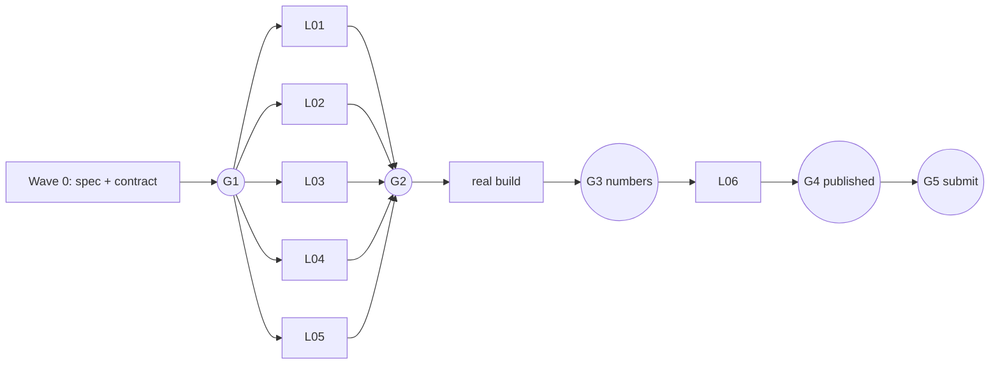

# Development plan: Tomato Harvest POC v1

14 Nov 2026 · Integrator space (`dwarf-tomato-harvest-forecast`, branch `tomato-harvest-poc`) · Implements SPEC.md v0.1

SPEC.md says **what** to build and wins on any detail. This file says **who builds what, in what order, and how the pieces meet**. About 10 working hours to submission (Sun 15 Nov, 12:00 PM).

---

## 1. How the lanes work

**Spaces.** One agent per lane, each in its own git worktree on branch `lane/LNN-name`, cut from `tomato-harvest-poc`. The integrator space (this checkout) owns shared files, merges lanes, runs the real-data build and holds the gates.

**Kickoff prompt** (change the lane):

> You are lane L01 (Forecast & confidence) on the Tomato Harvest POC. Read CLAUDE.md, SPEC.md, docs/development-plan.md §1–§4, then docs/lanes/L01-forecast-confidence.md. Write only the files your lane lists under "Owns". If you need any other file changed, stop and record it under "Blocked" in your status log. Build against the contracts and fixtures; don't wait for other lanes. Run `make test` before every commit. When done, fill in the hand-off in your status log.

**Rules on top of CLAUDE.md**

1. **Ownership.** A lane writes only its "Owns" list. The integrator owns SPEC.md, CLAUDE.md, Makefile, `requirements-poc.txt`, `.gitignore`, `harvest/common.py`, `harvest/publish.py`, `contracts/`, `tests/fixtures/`, `docs/decisions.md` and this file.
2. **Contracts first.** Build against SPEC §3–§9 and `contracts/app-data.md`. Use `tests/fixtures/` and `app/mock/` instead of waiting for other lanes.
3. **Shared inputs.** Every space reads inputs from the integrator checkout's `out/`: run `export HARVEST_INPUTS="/Users/aagam/CDA Hack/dwarf-tomato-harvest-forecast/out"` before `make`. That folder also holds `thumbs/` (gitignored, needed by L03). Don't regenerate `out/`. Use the integrator's `.venv` via `make PY="/Users/aagam/CDA Hack/dwarf-tomato-harvest-forecast/.venv/bin/python" test`, or run `make setup` in your space.
4. **Blocked protocol.** Need a decision, a contract change, a new dependency or an edit outside your files? Write it under "Blocked" and stop that thread. The integrator resolves it.
5. **Hand-off.** Done when every "Done when" item is checked, `make test` is green and the hand-off is filled in (built, how checked, known limits, follow-ups).
6. **Mock data never ships.** Mock files carry `"mock": true`; `publish.py` refuses them.
7. **Time box.** Each wave-1 lane has about 4 hours. At 3 hours, stop adding and finish tests and hand-off. A smaller lane that is tested beats a bigger one that isn't.

---

## 2. Lanes

| ID | Lane | Owns (main paths) | Wave | Starts when | Status |
|---|---|---|---|---|---|
| [L01](lanes/L01-forecast-confidence.md) | Forecast, confidence & timing test | `harvest/forecast.py`, `confidence.py`, `backtest.py`, their tests | 1 | G1 | not started |
| [L02](lanes/L02-economics-whatif.md) | Harvest window, profit & temperature what-if | `harvest/economics.py`, `whatif.py`, their tests | 1 | G1 | not started |
| [L03](lanes/L03-evidence-alerts.md) | Evidence trail, photos & alerts | `harvest/evidence.py`, `alerts.py`, `scripts/select_photos.py`, `app/data/photos/`, their tests | 1 | G1 | not started |
| [L04](lanes/L04-web-app.md) | Web app & demo customers | `app/` (not `app/data/`), `config/customers.yaml` | 1 | G1 | not started |
| [L05](lanes/L05-assumptions-replication.md) | Assumptions, outside data & replication | `config/crop.yaml`, `docs/assumptions.md`, `docs/input-contract.md`, `scripts/outside_data/` | 1 | G1 | not started |
| [L06](lanes/L06-review-story.md) | Fresh-eyes review, demo script & submission text | `reports/launch-review.md`, `docs/demo-script.md`, `docs/submission.md` | 3 | G3 | not started |

**Wave 2 (UI/UX, D15–D18):**

| ID | Lane | Owns (main paths) | Starts when | Status |
|---|---|---|---|---|
| [L07](lanes/L07-react-shell.md) | React shell, design system & screens | `web/` except charts and Add-a-room | approval | not started |
| [L08](lanes/L08-charts.md) | Charts | `web/src/charts/` | approval | not started |
| [L09](lanes/L09-pipeline-wave2.md) | Pipeline: optimal zone, look day, planting date, explanations | `harvest/explain.py`, publish/common/config for this wave | approval | not started |
| [L10](lanes/L10-add-room.md) | Add-a-room form & input checks | `web/src/screens/AddRoom*`, `web/src/lib/validate*`, `docs/input-contract.md` | approval | not started |
| L06 (again) | Review of the redesign, updated demo script | review and script | after wave-2 merge | not started |

Design source of truth: `docs/DESIGN.md`. At most five agents at once.

---

## 3. Schedule

| Wave | Hours from G1 | Lanes running | Integrator does | Ends with |
|---|---|---|---|---|
| 0 | −1 to 0 | — | spec, contract, `common.py`, fixtures, Makefile, briefs | **G1** user approval |
| 1 | 0 to 4 | L01–L05 | answers Blocked items; merges finished lanes | **G2** all merged, tests green |
| 2 | 4 to 5.5 | — | writes `publish.py` glue, `make build` on real inputs, fixes | **G3** user reviews numbers |
| 3 | 5.5 to 7.5 | L06; owning lanes fix what it finds | publishes the Artifact | **G4** |
| 4 | 7.5 to 10 | — | supports the team recording the video; submission | **G5** |



**Critical path:** L01 → L02 (economics reads the forecast) → real build → G3. L02 starts at once on the fixture forecast in `tests/fixtures/`, so it doesn't wait.

---

## 4. How the pieces meet

```
out/ (main's derived tables)
   │  harvest/common.py  load_inputs(), rooms, replay dates
   ▼
L01 forecast.py   forecast(room, today) -> daily % red + band, model used
    confidence.py confidence(room, today) -> level + 3 parts
    backtest.py   timing test table
   ▼
L02 economics.py  profit_by_day(forecast, costs) -> curve, window (3 dates)
    whatif.py     whatif(room, today, delta_c) -> new window + cost
L03 evidence.py   evidence(room, today) -> photo + measurements
    alerts.py     alerts(today) -> list
L05 config/crop.yaml (settings + sources)
   ▼
harvest/publish.py (integrator) -> app/data/*.json  (contracts/app-data.md)
   ▼
L04 app/ reads app/data/ (builds on app/mock/ first)
```

Function signatures above are fixed in `contracts/app-data.md` §2. Changing one goes through the integrator.
